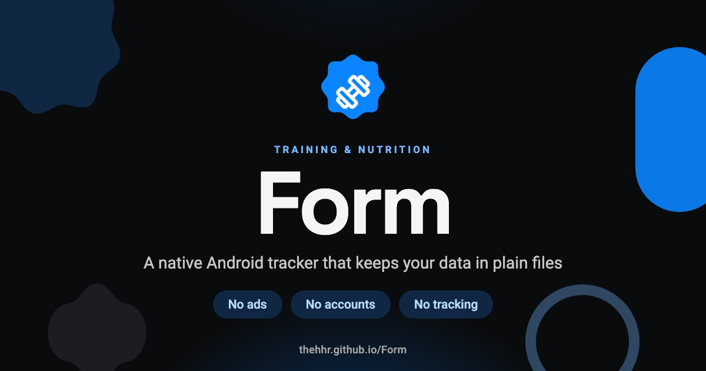
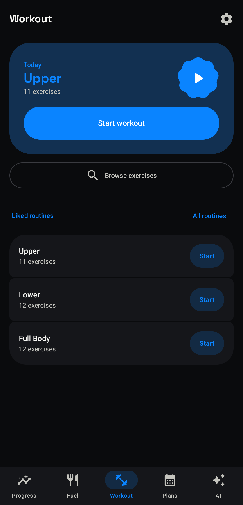
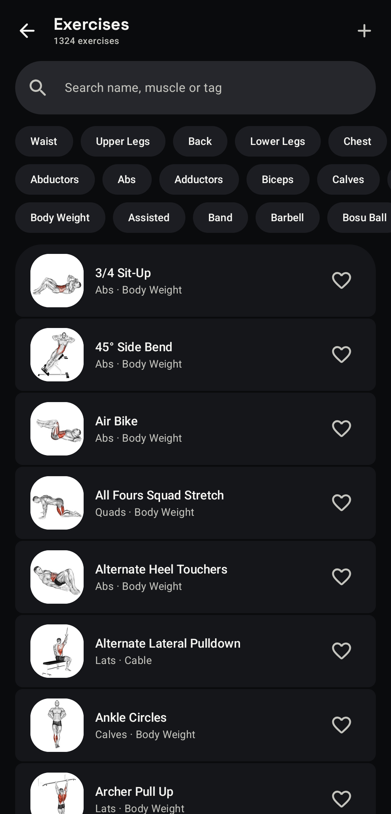
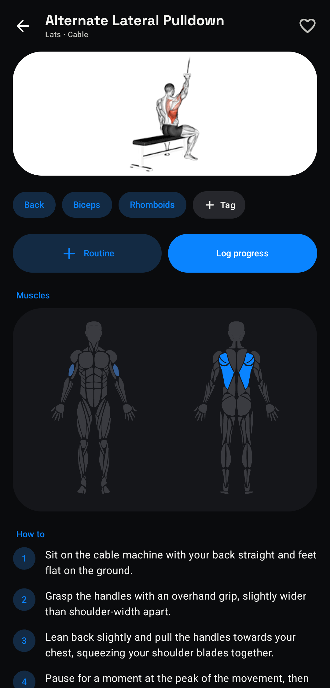
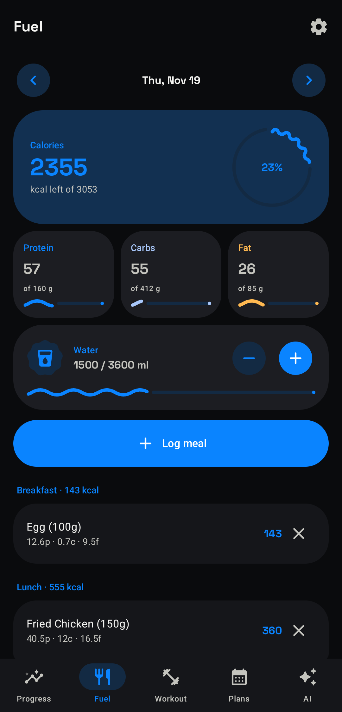
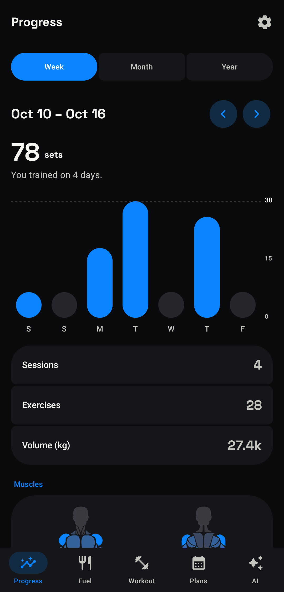
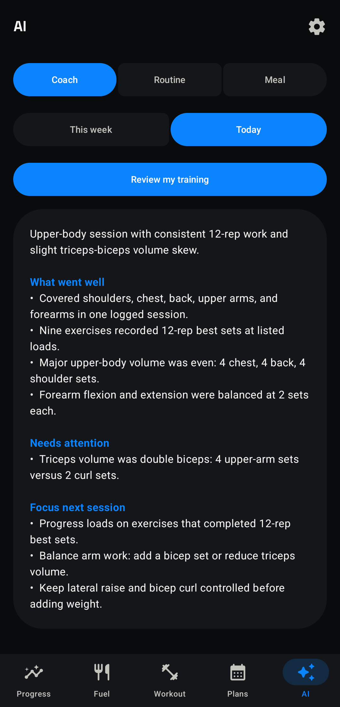

<div align="center">



<h3>A training and nutrition tracker for Android that keeps your data in plain files you own.</h3>

<p>
  <a href="https://github.com/TheHHR/Form/releases/latest"></a>
  <a href="https://github.com/TheHHR/Form/releases"></a>
  
</p>

<p>
  <a href="https://github.com/TheHHR/Form/releases/latest"></a>
  &nbsp;
  <a href="https://apps.obtainium.imranr.dev/redirect?r=obtainium://app/%7B%22id%22%3A%22com.thehhr.form%22%2C%22url%22%3A%22https%3A%2F%2Fgithub.com%2FTheHHR%2FForm%22%2C%22author%22%3A%22TheHHR%22%2C%22name%22%3A%22Form%22%7D"></a>
</p>

**No ads · No accounts · No tracking**

[Website](https://thehhr.github.io/Form/) · [Download](https://github.com/TheHHR/Form/releases/latest) · [Donate](https://thehhr.github.io/Form/#donate)

</div>

<br>

<p align="center">
  
  
  
  
  
  
</p>

## ✨ Features

<table>
<tr>
<td width="50%" valign="top">

### 🏋️ Train
Plan your week, then run a guided workout: rest timers, a fullscreen timer you control with one tap, supersets, and sets that carry your edits forward. A live notification, home-screen widget, Quick Settings tile and app shortcuts keep it a tap away.

</td>
<td width="50%" valign="top">

### 📚 1,324 exercises
Animated demos, muscle maps and step-by-step instructions. Filter by body part, muscle, equipment or your own tags. Pills with no matches dim and move aside. Add custom exercises too.

</td>
</tr>
<tr>
<td valign="top">

### 🍽️ Fuel
Calories, macros and water against targets calculated for you. Log from your meal library, enter one by hand, or hold a meal slot to skip it.

</td>
<td valign="top">

### 📈 Progress
Week, month and year charts, a training calendar, muscle heat maps, personal records and full history.

</td>
</tr>
<tr>
<td valign="top">

### ✨ AI coach (bring your own key)
Weekly and daily reviews, routines built from a sentence, and meals logged from a description or a photo. Works with OpenRouter, OpenAI, Gemini or a custom endpoint. Requests go straight from your phone to your provider.

</td>
<td valign="top">

### 🔒 Own your data
Everything lives in 5 plain `.md` files in a folder you choose, or `Documents/Form` if you skip the picker. Open them in Obsidian or any editor. No servers, no accounts, no analytics.

</td>
</tr>
</table>

## 🎨 Material 3 Expressive

Built natively with Kotlin and Jetpack Compose, following Material 3 Expressive:

- springy motion and predictive back
- shape morphs and wavy progress
- light, dark or system theme
- eight accent colours, or your wallpaper colours on Android 12+
- optional Health Connect sync: workouts and meals out, body weight in

## 📦 Download

Grab the signed APK from **[Releases](https://github.com/TheHHR/Form/releases/latest)**, or add the repo to [Obtainium](https://github.com/ImranR98/Obtainium) for automatic updates. Every push to `main` builds a new release. The app can also check for updates in **Settings → About**.

## 🛠️ Building

```bash
cd native
./gradlew assembleProdDebug          # debug build
./gradlew testProdDebugUnitTest      # unit tests
```

| Path | What's there |
|---|---|
| `native/` | The Android app (Kotlin, Compose, Material 3 Expressive, Glance widget) |
| `native/version.properties` | App version; bump it to ship a release |
| `www/data`, `www/images`, `www/videos` | Exercise catalog, stills and animations bundled into the APK |
| `docs/` | The website ([thehhr.github.io/Form](https://thehhr.github.io/Form/)) |
| `.github/workflows/android-build.yml` | CI: builds, signs and publishes the release APK |

## 💙 Support

If Form helps your training, consider [supporting development](https://thehhr.github.io/Form/#donate).

## 🙏 Credits

- [exercises-dataset](https://github.com/hasaneyldrm/exercises-dataset) by [@hasaneyldrm](https://github.com/hasaneyldrm): the exercise library (1,324 exercises with animations, categories and muscle data)
- [MuscleMapJS](https://github.com/abdofallah/MuscleMapJS) by [@abdofallah](https://github.com/abdofallah): the human muscle map
